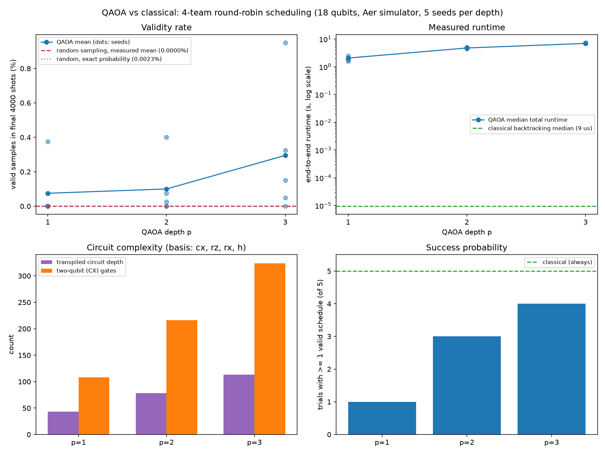
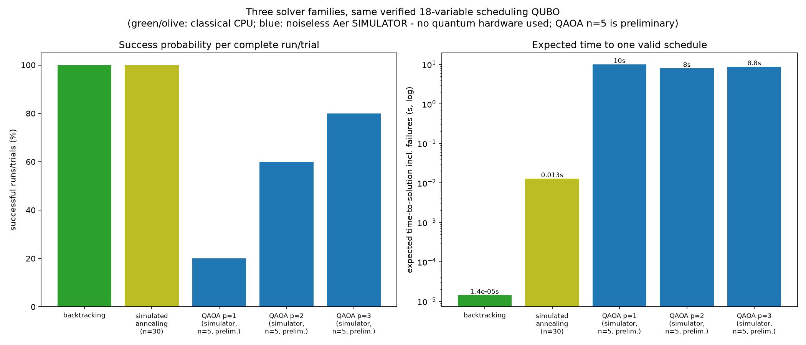

# Results

All values below were re-verified against the raw measurement files in
`results/` (`benchmark_results.json`, `qubo_verification.json`,
`quantum_qaoa_result.json`, `sa_benchmark_results.json`, and the
`wrestling_*.json` files, including the W5–W5D QAOA results). Every number is a real measurement; nothing is
estimated. Two earlier informal statements were corrected during this
verification (see "Corrections" at the end).

## Methodology

- **Problem:** 4-team single round-robin as an 18-variable QUBO (verified
  exhaustively: exactly 6 of 262,144 assignments have energy 0, all 6 are
  valid, minimum nonzero energy is 3). Valid solutions are mirrored to full
  6-round double round-robins and checked by the independent Phase 1
  validator.
- **Quantum:** QAOA at depths p = 1, 2, 3 on the Qiskit Aer simulator
  (`SamplerV2`), 18 qubits. Classical optimizer COBYLA, max 40 iterations,
  1,000 shots per objective evaluation, and a separate final evaluation of
  4,000 shots at the best parameters. Five fixed seeds per depth
  (11, 22, 33, 44, 55). Valid-sample rate = measurement counts of
  zero-energy bitstrings in the final 4,000 shots only.
- **Baselines:** (a) classical backtracking on the identical 18-variable
  problem, 200 repeats; (b) uniformly random 18-bit strings, 4,000 per seed,
  scored identically to QAOA samples.
- **Timing:** `time.perf_counter()`. QAOA "total time" is end-to-end hybrid
  time including classical optimizer overhead.

## Comparison table (verified against raw JSON)

| Config | Optimizer evals | Final shots | Mean valid % (± std dev) | Successful trials | Best energy | Median runtime | Circuit depth | 2-qubit gates |
|---|---|---|---|---|---|---|---|---|
| QAOA p=1 | 24–34 | 4,000 | 0.075 (± 0.168) | 1/5 | 0 | 2.06 s | 43 | 108 |
| QAOA p=2 | 35–40 | 4,000 | 0.100 (± 0.170) | 3/5 | 0 | 4.76 s | 78 | 216 |
| QAOA p=3 | 40 (capped) | 4,000 | 0.295 (± 0.387) | 4/5 | 0 | 6.95 s | 113 | 324 |
| Uniform random | – | 4,000 × 5 | 0.000 | 0/5 | 3 | 0.0145 s | – | – |
| Classical backtracking | – | – | 100 (all 200 runs) | 200/200 | 0 | 9.5 µs | – | – |

Classical timing variability over 200 repeats: median 9.5 µs, mean 13.6 µs,
std dev 38.9 µs, min 9.0 µs, max 505.6 µs (occasional OS scheduling spikes).
These figures come from the Phase 2C run (`benchmark_results.json`). The
Phase 2F section below reports a backtracking median of 14.3 µs: that is a
separate, fresh 200-repeat measurement taken during the SA benchmark
(`sa_benchmark_results.json`), not a typo. The ~5 µs gap is ordinary
run-to-run timing variation at microsecond scale.

**Time-to-valid-solution** — defined as (total wall time across all 5 trials
of a configuration) ÷ (number of trials that produced at least one valid
schedule), so failed attempts are charged to the method:

| Method | Time-to-valid |
|---|---|
| QAOA p=1 | 10.00 s (10.00 s total / 1 success) |
| QAOA p=2 | 7.95 s (23.86 s total / 3 successes) |
| QAOA p=3 | 8.77 s (35.08 s total / 4 successes) |
| Classical | 0.0000095 s (every run succeeds) |

Charts: 
(validity rates per seed and mean, runtimes on a log scale, circuit
complexity, success probability — confirmed to match the JSON data
point-for-point).

## Conclusions (plain English)

1. **QAOA genuinely works on this problem — sometimes.** It produced real,
   validator-confirmed tournament schedules. Its best measured valid rate
   (0.95%, p=3 seed 33) is ~400× the exact random-guessing probability
   (6/262,144 = 0.0023%), and every depth's mean rate exceeded it by
   30–130×. The quantum circuit demonstrably concentrates probability on
   correct schedules.

2. **Deeper circuits improved reliability in this run.** Successful trials
   rose 1/5 → 3/5 → 4/5 and mean valid rate 0.075% → 0.100% → 0.295% from
   p=1 to p=3. Plain-English reason: each extra QAOA layer alternates one
   more "energy-aware" step (phases that mark low-energy schedules) with one
   more "mixing" step (spreading amplitude between candidates), letting the
   state express finer distinctions between good and bad schedules — at the
   price of more parameters, a longer circuit (108 → 324 two-qubit gates),
   and a harder optimization. With only 5 seeds and large variance, this
   trend is suggestive rather than conclusive.

3. **Time-to-valid-solution did not clearly improve with depth** (10.0 →
   8.0 → 8.8 s): higher success rates roughly offset longer runtimes.

4. **Classical Python remained enormously faster.** Backtracking solved the
   identical problem in ~10 µs with a 100% success rate — about six orders
   of magnitude faster than the QAOA pipeline. Reasons: the instance is
   tiny; backtracking prunes the search space exactly; and QAOA pays for
   thousands of circuit simulations plus a classical optimization loop on
   top.

5. **Why we cannot claim quantum speedup.** (a) Classical was measured to be
   vastly faster; (b) the simulator is noiseless and its timings do not
   represent real hardware; (c) sample sizes are small; (d) the problem was
   simplified specifically so it could be simulated. Any speedup claim from
   this setup would be scientifically meaningless — the honest claim is
   "QAOA solves the problem far better than chance, far worse than a
   classical solver, on this educational instance."

6. **Zero random-baseline successes are expected, not remarkable.** With
   success probability 0.0023% per draw, the expected number of valid
   schedules in 20,000 draws is 0.458 and the chance of seeing none is 63%.
   The random baseline mainly confirms that valid schedules are rare; the
   quantitative anchor for "better than chance" is the exact probability,
   not the empirical zero.

## Uncertainty statement

Five seeds per depth is a small sample. Standard deviations are as large as
the means (p=3: 0.295% ± 0.387%); the p=1 mean rests on a single successful
seed; and success counts such as 4/5 have wide binomial confidence
intervals. The depth trend should be treated as a hypothesis supported by
this run, to be confirmed with more seeds (and, for p=3, a larger optimizer
budget, since all p=3 trials hit the 40-iteration cap).

## Phase 2F addition: simulated annealing (third solver family)

Classical **simulated annealing** (SA) was added to test whether a classical
heuristic working on the *same verified QUBO energy landscape* outperforms
QAOA. Beginner-friendly explanation: SA starts from a random schedule
guess, repeatedly flips one random bit, always keeps improvements, and
sometimes accepts worse candidates with probability exp(−ΔE/T) — a
"temperature" T that slowly cools, so the search explores early and settles
later. It stops as soon as it hits a valid (energy-0) schedule.

Settings: max 50,000 iterations, T₀ = 3.0, geometric cooling rate 0.9995,
one-bit-flip neighbors, unchanged `energy()` function. 30 independent runs
(seeds 101–130) after a 5-run pilot. Raw data:
`results/sa_benchmark_results.json`; QAOA numbers below are the stored
Phase 2C measurements (not rerun) and remain **preliminary (n=5)**.

| Method | Environment | Runs | Success % | Best E | Median time | Expected TTS (incl. failures) | TTS99 |
|---|---|---|---|---|---|---|---|
| Backtracking | classical CPU | 200 | 100 | 0 | 14.3 µs | ~14 µs | ~same |
| Simulated annealing | classical CPU | 30 | **100** | 0 | 11.5 ms | 12.8 ms | 30.7 ms* |
| QAOA p=1 (prelim.) | noiseless simulator | 5 | 20 | 0 | 2.06 s | 10.0 s | 42.5 s** |
| QAOA p=2 (prelim.) | noiseless simulator | 5 | 60 | 0 | 4.76 s | 7.95 s | 23.9 s** |
| QAOA p=3 (prelim.) | noiseless simulator | 5 | 80 | 0 | 6.95 s | 8.77 s | 19.9 s** |

Backtracking was re-measured here (200 fresh repeats); its 14.3 µs median
differs from the Phase 2C 9.5 µs median only because it is a separate run.

\* All 30 SA runs succeeded, so the TTS99 formula is undefined; the
99th-percentile single-run time is reported instead.
\*\* TTS99 = median run time × ln(0.01)/ln(1−p), assuming independent
repeated attempts; p is estimated from only 5 trials, so these values carry
wide binomial uncertainty.

SA detail (30 runs): mean time 12.8 ms (σ 7.6 ms, min 1.5 ms, max 30.7 ms),
mean 933 iterations, median 838 energy evaluations per run, every success
confirmed by the independent validator after mirroring.

**Budget fairness note:** an SA "run" (≤ 50,001 energy evaluations, typically
~900) and a QAOA "trial" (24–40 optimizer evaluations, the measured
Phase 2C range, × 1,000 shots + 4,000
final shots) are very different computational budgets; equal success counts
do not imply equal effort. Comparison chart:

**Does this change the original conclusion?** It sharpens it. The ranking on
this instance is: exact backtracking (µs) ≪ simulated annealing (ms) ≪
QAOA on a simulator (seconds). Even restricted to the identical QUBO energy
landscape — the fairest possible comparison for QAOA — a simple classical
heuristic is ~3 orders of magnitude faster and more reliable (30/30 vs at
best 4/5). The original conclusion stands: no quantum advantage on this
educational instance; QAOA's value here is educational and methodological.

## Wrestling tournament simulation (Phases W1–W5D)

A separate simulation of a fictional high-school wrestling tournament
(seed 42). Phases W1–W4 are fully classical; Phases W5–W5D add QAOA on the
Aer **noiseless simulator** (no IBM hardware was used). Raw data:
`results/wrestling_brackets.json`, `results/wrestling_mat_schedule.json`,
`results/wrestling_qubo_feasibility.json`, and the four
`results/wrestling_qaoa_*.json` files. All values below are taken from those
files.

**Problem and assumptions.** 12 fictional schools enter at most one wrestler
in each of 14 sample weight classes. Each weight class runs a
single-elimination championship bracket (unseeded, placement in roster
order). Matches are scheduled on 6 identical mats in equal-length time
slots, and a wrestler must rest at least 1 slot between matches. Consolation
brackets, real match durations, actual results and official rules are not
modeled (see LIMITATIONS.md §5).

**W1–W2: rosters and championship brackets**

| Quantity | Recorded value |
|---|---|
| Schools | 12 |
| Weight classes | 14 |
| Entrants (registered wrestlers) | 132 (of 168 possible positions; 36 empty) |
| Single-elimination championship brackets | 14 |
| First-round byes | 60 |
| Contested championship-bracket matches | 118 |

**W3: mat schedule (deterministic greedy list scheduling)**

| Quantity | Recorded value |
|---|---|
| Mats | 6 |
| Minimum rest (model setting) | 1 time slot |
| Matches scheduled | 118 |
| Scheduled time slots (makespan) | 20 |
| Theoretical lower bound | 20 = max(⌈118 / 6⌉, longest feeder chain) |
| Mat utilization | 98.3% (118 of 120 mat-slots) |
| Independent validator | VALID |

The greedy schedule meets the lower bound, so no solver, classical or
quantum, can shorten it under this model.

**W4: mat-selection QUBO (classical feasibility study only)**

At time slot 17 of the W3 schedule, 14 matches are ready. The task is to
choose exactly k = 6 of them (6 mats; 10 distinct weight classes in the pool)
with at most one match per weight class, maximizing a bracket-progression
score u ∈ {1, 2}.

- **Formulation:** 14 binary variables (14 qubits if run on QAOA).
  H(x) = A·(Σxᵢ − 6)² + B·Σ_{same-weight i<j} xᵢxⱼ − C·Σuᵢxᵢ with
  A = B = 13 and C = 1.
- **Size:** 91 distinct quadratic terms. Every pair is coupled by the
  cardinality penalty, and 4 of those pairs also get the extra same-weight
  coefficient. (An earlier report said 95 because it counted those 4 pairs
  twice. The QUBO itself was never wrong; only the reported count was.)
- **Exhaustive verification:** all 16,384 assignments checked; 1,289 are
  feasible; exactly 1 ground state, at energy −12, which is feasible and
  equals the best feasible selection.
- **Verified classical optimum:** score **12**, found by both brute-force
  enumeration and the greedy heuristic. Completing the tournament from the
  optimal selection passes the independent W3 validator.
- **Caveat:** this snapshot is easy for classical greedy. The six matches
  with score 2 are all in different weight classes, so taking the
  highest scores first is already optimal. The instance shows that the
  model is correct; it does not show that a stronger solver is needed.

**Classical baseline for the W4 instance** (median of 20 repeats, measured
in each W5 run): brute force 3.12–3.21 ms, greedy 7.0–9.8 µs. Both always
return the optimum, 12. Exact uniform-random reference: 1,289 of 16,384
selections are feasible (7.867%), 1 is optimal (0.0061%), and the mean
energy of a random selection is 61.5.

### W5: QAOA on the 14-variable QUBO (single seed, 42)

Setup: the W4 QUBO is converted to an Ising operator (checked against the
original energy on all 16,384 assignments; constant offset 61.5). The
circuit uses the operator divided by its largest coefficient (15.75), which
rescales the angles only. All samples are scored with the original W4
energy. COBYLA with at most 40 evaluations, 1,000 shots per evaluation and
4,000 final shots. A pilot ran before each main run.

| Metric | p=1 | p=2 |
|---|---|---|
| Feasible samples (final 4,000) | 7.78% | 20.80% |
| Optimal samples | 0 (0.000%) | 3 (0.075%) |
| Best score / best QUBO energy | 11 / −11 | **12 / −12** |
| Final-sample mean energy\* | 56.96 | 142.91 |
| Optimizer evaluations / total shots | 34 / 38,000 | 36 / 40,000 |
| Circuit depth / two-qubit (CX) gates | 79 / 182 | 123 / 364 |
| Runtime (quantum pipeline) | 1.48 s | 2.64 s |
| Distinct feasible selections validated | 280, 0 failures | 599, 0 failures |

\* Computed from the saved final counts in each JSON (the stored
`final_mean_energy` field is COBYLA's last objective value, a different
quantity).

At seed 42, p=2 found the optimum and was well above random on
feasibility, but its mean energy was worse than random (61.5). The sweep
below shows that this single seed was not representative.

### W5C: five-seed reproducibility sweep (seeds 11, 22, 33, 44, 55)

Same settings at each depth. Mean ± standard deviation over 5 seeds, with
95% t-intervals for the means. Raw data:
`results/wrestling_qaoa_sweep_results.json`.

| Metric | p=1 | p=2 | Random (exact) |
|---|---|---|---|
| Feasible samples | 14.93 ± 8.45% [4.4, 25.4] | 18.66 ± 8.95% [7.5, 29.8] | 7.867% |
| Runs finding the optimum | 3/5 (95% CI 15–95%) | 2/5 (95% CI 5–85%) | 21.7% per run |
| Total optimal hits (20,000 shots) | 8 | 4 | 1.22 expected |
| Best score | 11.6 ± 0.55 | 11.4 ± 0.55 | – |
| Final-sample mean energy | 39.5 ± 28.3 | 45.0 ± 21.0 | 61.5 |
| Optimizer's best objective | 36.4 ± 26.0 | 40.9 ± 19.0 | – |
| Samples with excessive violations (penalty ≥ 208) | 5.88 ± 5.56% | 8.12 ± 5.06% | 9.63% |
| Optimizer evaluations (runs hitting the 40 cap) | 31.0 ± 5.4 (1/5) | 38.6 ± 1.9 (3/5) | – |
| Runtime | 1.38 ± 0.26 s | 2.80 ± 0.19 s | – |

Intervals for "runs finding the optimum" are Clopper-Pearson.

- **p=2 did not consistently beat p=1.** It had higher feasibility on 3 of 5
  matched seeds, and the difference in means is not significant
  (Mann-Whitney exact p = 0.42).
- **Results depend strongly on the seed.** Each depth has runs around
  20–28% feasible and runs close to random (about 6–7%).
- **Mean energy is a weak guide to feasibility.** The rank correlation
  between final-sample energy and feasibility is −0.59 (p = 0.07, n = 10),
  because rare extreme-violation samples dominate the mean.
- **The optimizer's estimate is optimistic.** In all 10 runs the final
  sample's energy was higher than the optimizer's best objective, by
  3.64 ± 2.84 on average. The 95% CI is [1.60, 5.67] with df = 9; it was
  stored as null in the sweep file because of a missing t value, and is
  corrected in `results/wrestling_qaoa_sweep_ci_correction.json`.
- **Probability note:** a uniform random sampler has about a 21.7% chance of
  hitting the unique optimum at least once in 4,000 samples, but only about
  a 0.2% chance of hitting it three or more times. A single "found the
  optimum" is therefore weak evidence.

### W5D: fixed vs independent sampling seeds (p=1, 10 matched pairs)

The question: does reusing one fixed sampler seed during optimization (with
which the same parameters always return the same 1,000 shots) cause the
optimizer gap? Strategy A reuses the fixed seed and reproduces the original
method bit for bit. Strategy B gives every evaluation its own reproducible
seed. Both start from the same initial parameters for each trial seed
(11–110). The final parameters are scored independently by an exact
statevector calculation and a separate 50,000-shot sample. Raw data:
`results/wrestling_qaoa_sampling_results.json`.

| Metric (mean ± SD, 10 runs) | A: fixed seed | B: independent seeds |
|---|---|---|
| Optimizer's best estimated energy | 47.1 ± 21.0 | 53.2 ± 10.8 |
| Exact final energy | 50.1 ± 22.0 | 57.7 ± 11.2 |
| Gap (exact − estimate) | 3.01 ± 2.52 [1.20, 4.81] | 4.53 ± 1.54 [3.42, 5.63] |
| Runs with positive gap | 9/10 | 10/10 |
| Exact feasible probability | 11.2 ± 7.1% | 10.7 ± 5.3% |
| Exact optimal probability | 0.026 ± 0.036% | 0.008 ± 0.004% |
| Runs finding the optimum (final 4,000) | 5/10 | 2/10 |
| Optimizer evaluations | 31.2 ± 4.5 | 28.2 ± 2.2 |
| Runtime | 1.41 ± 0.20 s | 1.25 ± 0.09 s |
| Circuit depth / CX gates | 79 / 182 | 79 / 182 |

Paired differences (B − A) were not significant: gap +1.52 [−0.26, 3.29]
(Wilcoxon p = 0.105), exact energy +7.6 [−5.4, 20.5] (p = 0.375),
feasibility −0.46 points [−4.2, 3.2] (p = 1.0). The 50,000-shot energies
agreed with the exact values to within 0.83. Every feasible sample under
both strategies passed the independent validator.

**Interpretation.** The gap is not caused by fixed seeding: it persists
with independent seeds. It is consistent with selection bias. COBYLA keeps
the lowest of about 30 noisy estimates, each with roughly ±2.5 of shot
noise (median standard error 2.55), and the lowest is biased downward.
Most p=1 runs end near the random-guessing energy: an exact energy of 57
or higher in 7/10 (A) and 8/10 (B) runs.

### Wrestling conclusion: no quantum advantage

On this 14-variable instance, classical greedy finds the optimum in about
10 µs, every time. QAOA on a noiseless simulator takes 1–3 s per run, finds
the optimum in only some runs, and reaches feasibility rates of roughly
11–19% on average, compared with 7.9% for random guessing. Increasing depth
from p=1 to p=2 did not give a consistent, statistically supported
improvement. No quantum advantage was demonstrated, and none is claimed.

## Corrections made during verification

1. An earlier summary said "two p=1 seeds succeeded" in the sweep. The raw
   data shows exactly **one** p=1 success (seed 44). The confusion arose
   from a separate earlier p=1 experiment (seed 42) that also succeeded; it
   used the same settings but is not part of the 5-seed sweep.
2. An earlier summary quoted the classical maximum runtime as 86 µs; the
   recorded value is **505.6 µs** (median 9.5 µs was correct).
3. The W4 report listed 95 quadratic terms because it counted the 4
   same-weight pairs twice. The correct number of distinct terms is **91**.
   The energy function, the optimum and all checks are unchanged.
4. The W5C sweep file stores the 95% CI of the optimizer gap (n = 10) as
   null, because only the df = 4 t value was tabulated. The corrected
   interval [1.60, 5.67] (df = 9) was computed from the saved trials,
   without rerunning anything, and is stored in
   `wrestling_qaoa_sweep_ci_correction.json`.
